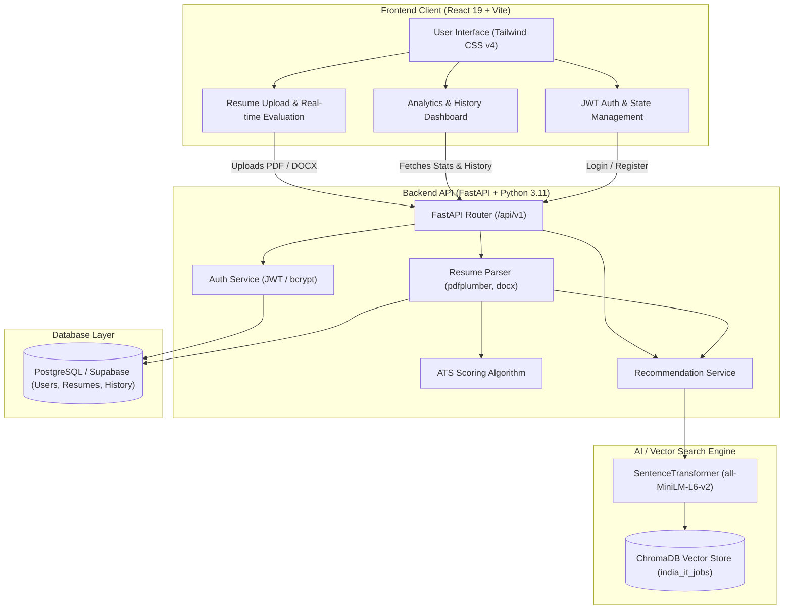

<div align="center">

# 🎯 HireChance

### AI-Powered Placement Prediction, ATS Resume Evaluation & Job Recommendation Platform

[](https://fastapi.tiangolo.com/)
[](https://react.dev/)
[](https://vitejs.dev/)
[](https://tailwindcss.com/)
[](https://www.python.org/)
[](https://www.postgresql.org/)
[](https://www.trychroma.com/)
[](https://www.docker.com/)
[](https://azure.microsoft.com/)

<p align="center">
  <strong>Transforming campus and lateral recruitment with semantic resume intelligence, deep ATS scoring, and AI-driven vector job matching.</strong>
</p>

[Key Features](#-key-features) • [Architecture](#-architecture) • [Tech Stack](#-tech-stack) • [Quick Start](#-quick-start) • [Environment Setup](#-configuration--environment-variables) • [API Documentation](#-api-endpoints) • [Deployment](#-deployment--cicd)

---

</div>

## 📌 Overview

**HireChance** is a full-stack career acceleration and placement prediction platform. It bridges the gap between job candidates and real-world tech job openings by analyzing candidate resumes (PDF/DOCX), scoring ATS readability and structural health, and leveraging vector embeddings (`sentence-transformers/all-MiniLM-L6-v2`) with ChromaDB to recommend matching job opportunities across India's IT and technology landscape.

---

## ✨ Key Features

- **📄 Intelligent Resume Parsing & ATS Scoring**:
  - Deep text extraction for PDF and DOCX formats via `pdfplumber` and `python-docx`.
  - Automated ATS compliance scoring based on formatting, contact presence, section structure, and skill density.
  - Extraction of technical skills, work experience duration, tier-1/tier-2 academic institutions, and professional certifications.

- **🧠 AI Vector Search & Job Matching Engine**:
  - High-dimensional semantic embeddings with Hugging Face's `all-MiniLM-L6-v2` Sentence Transformer.
  - Persistent vector similarity searches powered by **ChromaDB**.
  - Contextual multi-factor fit scoring incorporating:
    - Semantic similarity between candidate resume & job descriptions.
    - Tier-1/Tier-2 company pedigree (e.g., Google, Amazon, Swiggy, Razorpay).
    - Tier-1/Tier-2 college rankings (e.g., IITs, NITs, BITS, IIITs).
    - Skill match overlap and seniority hierarchy alignment (Intern -> Junior -> Lead -> Director).

- **📊 Comprehensive Interactive Dashboard**:
  - Historical ATS score progression and evaluation tracking.
  - Detailed breakdown of matched skills, missing skills, and hiring possibilities.
  - Direct application URLs and company insight badges.

- **🔒 Production-Ready Security & Flexible Data Layer**:
  - JWT token-based authentication with bcrypt password hashing.
  - Seamless dual-mode database support: local PostgreSQL (Docker) or remote Supabase Cloud with automatic SSL configuration.

- **🐳 Fully Containerized & Cloud-Deployable**:
  - Out-of-the-box `docker-compose` orchestration for Backend, Frontend, and PostgreSQL.
  - GitHub Actions CI/CD workflows for **Azure App Service** (Backend) and **Azure Static Web Apps** (Frontend).

---

## 🏗️ Architecture



---

## 💻 Tech Stack

| Layer | Technologies |
| :--- | :--- |
| **Frontend** | React 19, Vite, Tailwind CSS v4, React Router DOM v7, Modern Glassmorphic UI |
| **Backend** | FastAPI, Python 3.11, Uvicorn, Gunicorn, Pydantic v2 |
| **AI / NLP & Vector DB** | Hugging Face `sentence-transformers` (`all-MiniLM-L6-v2`), ChromaDB, NumPy |
| **Document Processing** | `pdfplumber`, `python-docx` |
| **Database & ORM** | PostgreSQL 15, Supabase, SQLAlchemy 2.0, Alembic |
| **Authentication** | OAuth2 Password Bearer, JWT (JSON Web Tokens), `passlib` (bcrypt) |
| **DevOps & Cloud** | Docker, Docker Compose, GitHub Actions, Azure App Service, Azure Static Web Apps |

---

## 📂 Project Structure

```
hirechance-ui/
├── .github/
│   └── workflows/
│       ├── azure-deploy.yml               # Backend CI/CD to Azure App Service
│       └── azure-static-web-apps-*.yml    # Frontend CI/CD to Azure Static Web Apps
├── backend/
│   ├── app/
│   │   ├── api/                           # API routes & route dependencies
│   │   │   ├── routes/
│   │   │   │   ├── auth.py                # Register, login, user token verification
│   │   │   │   ├── resume.py              # Resume upload, parsing & evaluation
│   │   │   │   ├── recommend.py           # ML Job recommendation endpoints
│   │   │   │   └── dashboard.py           # Candidate analytics & resume history
│   │   │   └── dependencies.py            # Auth dependencies & DB sessions
│   │   ├── core/                          # App configuration & JWT security
│   │   ├── database/                      # SQLAlchemy session & Base definition
│   │   ├── models/                        # SQLAlchemy models (User, Resume)
│   │   ├── schemas/                       # Pydantic request/response models
│   │   ├── services/
│   │   │   ├── recommend_service.py       # SentenceTransformer + ChromaDB matcher
│   │   │   └── resume_service.py          # PDF/DOCX text & skill extraction
│   │   └── main.py                        # FastAPI application instance & routing
│   ├── india_job_vector_db/               # Persistent ChromaDB vector index
│   ├── Dockerfile                         # Python backend Docker container
│   ├── main.py                            # Root entrypoint for Azure / Gunicorn
│   ├── model.pkl                          # Recommender model metadata
│   └── requirements.txt                   # Backend Python dependencies
├── frontend/
│   ├── public/                            # Static assets
│   ├── src/
│   │   ├── components/                    # Header, Footer, and UI components
│   │   ├── config/                        # API base URL & runtime configs
│   │   ├── pages/                         # Home, Login, Register, Evaluate, Dashboard
│   │   ├── App.jsx                        # React Router layout & protected routes
│   │   ├── index.css                      # Tailwind CSS v4 design tokens
│   │   └── main.jsx                       # React DOM entrypoint
│   ├── Dockerfile                         # Frontend Vite container
│   └── package.json                       # Node dependencies & scripts
├── docker-compose.yml                     # Multi-container orchestration (Backend, Frontend, DB)
├── .env.example                           # Root environment variable template
└── README.md                              # Project documentation
```

---

## 🚀 Quick Start

### Option A: Run with Docker Compose (Recommended)

The easiest way to run the entire stack (Backend, Frontend, and PostgreSQL) is with Docker:

1. **Clone the repository:**
   ```bash
   git clone https://github.com/your-username/hirechance-ui.git
   cd hirechance-ui
   ```

2. **Configure environment variables:**
   ```bash
   cp .env.example .env
   ```

3. **Start all services:**
   ```bash
   docker compose up --build
   ```

4. **Access the applications:**
   - **Frontend UI**: [http://localhost:5173](http://localhost:5173)
   - **Backend API**: [http://localhost:8001](http://localhost:8001)
   - **Swagger Docs**: [http://localhost:8001/docs](http://localhost:8001/docs)

---

### Option B: Run Locally for Development

#### 1. Backend Setup

```bash
# Navigate to backend directory
cd backend

# Create and activate a Python virtual environment
python3.11 -m venv venv
source venv/bin/activate  # On Windows: venv\Scripts\activate

# Install dependencies
pip install -r requirements.txt

# Configure backend environment
cp .env.example .env

# Run FastAPI development server
uvicorn app.main:app --host 0.0.0.0 --port 8000 --reload
```

#### 2. Frontend Setup

```bash
# Navigate to frontend directory
cd frontend

# Install Node dependencies
npm install

# Configure frontend environment
cp .env.example .env

# Start Vite development server
npm run dev
```

The frontend will start at `http://localhost:5173`.

---

## ⚙️ Configuration & Environment Variables

Copy `.env.example` to `.env` in the root or in respective subdirectories:

### Root / Backend `.env`

```env
# ==========================================
# Database Configuration
# ==========================================
# Supabase / Cloud Postgres (Optional - takes precedence if set)
SUPABASE_DATABASE_URL=
SUPABASE_URL=
SUPABASE_KEY=

# Local PostgreSQL (Default fallback)
POSTGRES_USER=postgres
POSTGRES_PASSWORD=postgres
POSTGRES_DB=placement_db
POSTGRES_PORT=5433
POSTGRES_HOST=db

# ==========================================
# Backend Settings & JWT Security
# ==========================================
BACKEND_PORT=8001
JWT_SECRET_KEY=your_super_secret_jwt_key_here
ALGORITHM=HS256
ACCESS_TOKEN_EXPIRE_MINUTES=30
ALLOWED_ORIGINS=http://localhost:5173,http://localhost:3000

# ==========================================
# Frontend Configuration
# ==========================================
VITE_API_URL=http://localhost:8001
FRONTEND_PORT=5173
```

---

## 📡 API Endpoints

Interactive documentation is automatically generated by FastAPI and available at `/docs` (Swagger UI) or `/redoc` (ReDoc).

| Method | Endpoint | Description | Auth Required |
| :--- | :--- | :--- | :---: |
| `POST` | `/api/v1/auth/register` | Register a new user account | No |
| `POST` | `/api/v1/auth/login` | Login and obtain JWT access token | No |
| `GET` | `/api/v1/auth/me` | Retrieve currently authenticated user profile | **Yes** |
| `POST` | `/api/v1/resume/upload` | Upload PDF/DOCX resume, extract text, score ATS, and fetch job matches | **Yes** |
| `POST` | `/api/v1/recommend/predict` | Direct text-based vector recommendation query | No |
| `GET` | `/api/v1/dashboard/stats` | Retrieve candidate overview metrics & score statistics | **Yes** |
| `GET` | `/api/v1/dashboard/history` | Retrieve past uploaded resumes and evaluations | **Yes** |
| `GET` | `/health` | Service health status check | No |
| `GET` | `/debug/model` | Verify ChromaDB vector store & SentenceTransformer state | No |

---

## 🚢 Deployment & CI/CD

HireChance is configured with automated GitHub Actions pipelines:

1. **Backend Deployment (`.github/workflows/azure-deploy.yml`)**:
   - Builds backend dependencies with Python 3.11.
   - Deploys containerized/packaged FastAPI application directly to **Azure App Service**.
2. **Frontend Deployment (`.github/workflows/azure-static-web-apps-*.yml`)**:
   - Builds production Vite assets using Node.js 20.
   - Deploys static build (`dist/`) directly to **Azure Static Web Apps** with automatic preview environments on pull requests.

---

## 🧪 Testing

Run backend tests and recommender sanity checks:

```bash
cd backend
source venv/bin/activate
python test_recommender.py
python test_final.py
```

Run frontend linting:

```bash
cd frontend
npm run lint
```

---

## 📄 License

This project is licensed under the [MIT License](LICENSE).
